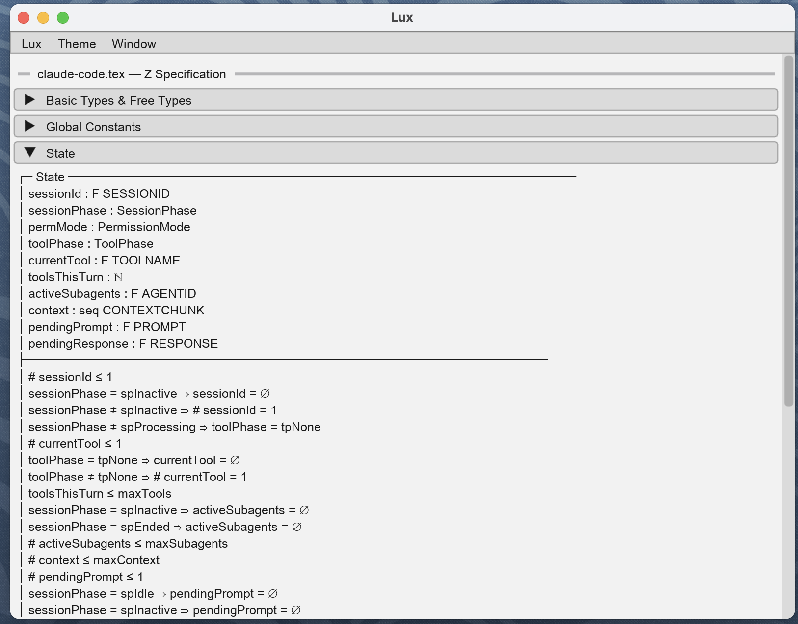

# z-spec

> Type-check, animate, and model-check Z specifications and B machines.

[](https://github.com/punt-labs/z-spec/blob/main/LICENSE)
[](https://github.com/punt-labs/z-spec/actions/workflows/test.yml)
[](https://pypi.org/project/punt-z-spec/)
[](https://pypi.org/project/punt-z-spec/)
[](https://github.com/punt-labs/z-spec/blob/main/prfaq.pdf)

**Platforms:** macOS, Linux

z-spec is a toolkit for formal specifications written in Z and the B-Method.
It provides a `z-spec` command-line tool, an MCP server (`zspec`) that AI
coding agents can call, and an optional Claude Code plugin whose slash
commands help you write specs and derive code and tests from them. It
type-checks specs with [fuzz](https://spivey.oriel.ox.ac.uk/mike/fuzz/),
animates and model-checks them with [ProB](https://prob.hhu.de/), and shows
the results in a [Lux](https://github.com/punt-labs/lux) window when Lux is
running.

## Quick Start

```bash
curl -fsSL https://raw.githubusercontent.com/punt-labs/z-spec/38d8814/install.sh | sh
```

This installs uv and Python 3.13 if they are missing, the `z-spec` CLI,
probcli (the ProB command-line tool), and fuzz (built from source), then the
Claude Code plugin, and finally runs `z-spec doctor`. If `claude` or `git` is
not installed, the plugin step is skipped and the CLI is still installed.

To install the CLI only — for agents other than Claude Code (Codex, Cursor, a
plain terminal) or where policy blocks plugin installation — pass
`--no-plugin` through the pipe with `sh -s --`:

```bash
curl -fsSL https://raw.githubusercontent.com/punt-labs/z-spec/38d8814/install.sh | sh -s -- --no-plugin
```

Where passing arguments is awkward (templated CI, proxies), set
`ZSPEC_NO_PLUGIN=1` instead. It takes effect only when set to exactly `1`:

```bash
curl -fsSL https://raw.githubusercontent.com/punt-labs/z-spec/38d8814/install.sh | ZSPEC_NO_PLUGIN=1 sh
```

<details>
<summary>Manual install (if you already have uv)</summary>

```bash
uv tool install punt-z-spec
```

```bash
claude plugin marketplace add punt-labs/claude-plugins
```

```bash
claude plugin install z-spec@punt-labs
```

```bash
z-spec doctor
```

A manual install does not install fuzz or probcli; run `/z-spec:setup all` in
Claude Code to install them.

</details>

<details>
<summary>Verify before running</summary>

```bash
curl -fsSL https://raw.githubusercontent.com/punt-labs/z-spec/38d8814/install.sh -o install.sh
```

```bash
shasum -a 256 install.sh
```

```bash
cat install.sh
```

```bash
sh install.sh
```

</details>

Then, inside Claude Code, in the repository you want to specify:

1. Turn z-spec on for this repository. The MCP tools refuse to run in a
   repository where z-spec is not enabled (see [Setup](#setup)).

   ```text
   /z-spec:enable
   ```

2. Install Lean 4 and any of fuzz or probcli that is still missing. Lean is
   needed only by `/z-spec:prove`, `/z-spec:oracle`, and `/z-spec:refine --lean`;
   skip this step if you do not use them.

   ```text
   /z-spec:setup all
   ```

3. Generate a first spec from your code:

   ```text
   /z-spec:code2model the user authentication system
   ```

4. Type-check it:

   ```text
   /z-spec:check docs/auth.tex
   ```

5. Animate and model-check it:

   ```text
   /z-spec:test docs/auth.tex
   ```

## Features

- **Generate Z specs** from a codebase or a system description (`/z-spec:code2model`)
- **Type-check** with fuzz (`/z-spec:check`)
- **Animate and model-check** with probcli (`/z-spec:test`)
- **Derive test cases** from a spec with the Test Template Framework (`/z-spec:partition`)
- **Generate code and tests** from a spec (`/z-spec:model2code`)
- **Audit test coverage** against the spec's constraints (`/z-spec:audit`)
- **Generate Lean 4 proof obligations** and build them with Lake, Lean's build tool (`/z-spec:prove`)
- **Generate runtime contracts** (preconditions, postconditions, invariants) from a spec (`/z-spec:contracts`)
- **Property-based testing** that runs generated operation sequences against code and an executable Lean model, and compares the results (`/z-spec:oracle`)
- **Check data refinement**: map code state to spec state with an abstraction function and check that each operation gives the same result either way (`/z-spec:refine`)
- **Elaborate** a spec with narrative from design documents (`/z-spec:elaborate`)
- **ProB-compatible output**: generated specs avoid B keyword conflicts, bound integers, and use flat schemas
- **B-Method support** (alpha): create, type-check, animate, and refine B machines (`/z-spec:b-create`, `/z-spec:b-check`, `/z-spec:b-animate`, `/z-spec:b-refine`)

## What It Looks Like

### A Generated Spec

```latex
\begin{schema}{State}
level : \nat \\
attempts : \nat \\
correct : \nat
\where
level \geq 1 \\
level \leq 26 \\
correct \leq attempts \\
attempts \leq 10000
\end{schema}

\begin{schema}{AdvanceLevel}
\Delta State \\
accuracy? : \nat
\where
accuracy? \geq 90 \\
accuracy? \leq 100 \\
level < 26 \\
level' = level + 1 \\
attempts' = attempts \\
correct' = correct
\end{schema}
```

### A Derived Partition Table

`/z-spec:partition` applies the [Test Template Framework](https://doi.org/10.1007/3-540-48257-1_11) (TTF) to derive conformance test cases from the spec's predicates:

1. **DNF decomposition** — split disjunctions into separate behavior branches
2. **Standard partitions** — type-based equivalence classes (endpoints, midpoints, every constructor)
3. **Boundary analysis** — values at and around each constraint edge

For the `AdvanceLevel` schema above:

| # | Class | Inputs | Pre-state | Expected |
|---|-------|--------|-----------|----------|
| 1 | Happy path | accuracy=95 | level=5 | level'=6 |
| 2 | Boundary: min accuracy | accuracy=90 | level=5 | level'=6 |
| 3 | Boundary: max level | accuracy=95 | level=25 | level'=26 |
| 4 | Rejected: low accuracy | accuracy=89 | level=5 | no change |
| 5 | Rejected: at max | accuracy=95 | level=26 | no change |

Add `--code swift` (or python, typescript, kotlin) to generate executable test cases.

### Visual Exploration With Lux

`show` displays a spec in a Lux window. The window always has a Spec tab, which
shows the Z model with collapsible sections. It adds a tab for each report
saved beside the spec: Fuzz (type-check), ProB (states explored, transitions
covered, checks passed, operation coverage), Partition, and Audit. When the
ProB report contains a counter-example, a Counter-Example tab shows the trace
step by step, with state values and the violated invariant. If Lux is not
running, `show` returns an error and nothing else is affected.



*A Z specification rendered in Lux, with collapsible sections for state schemas, invariants, and global constants. Run `show` again after editing the spec to refresh the window.*

## Commands

### Setup

| Command | Description |
|---------|-------------|
| `/z-spec:setup [check\|fuzz\|probcli\|lean\|all]` | Check or install fuzz, probcli, and Lean 4 (no argument is the same as `check`) |
| `/z-spec:doctor` | Check environment health |
| `/z-spec:enable` | Turn z-spec on in this repository |
| `/z-spec:disable` | Turn z-spec off in this repository |
| `/z-spec:help` | Interactive getting-started tutorial for your own spec |
| `/z-spec:cleanup [dir]` | Remove TeX tooling files (keeps .tex and .pdf) |

### Z Specification

| Command | Description |
|---------|-------------|
| `/z-spec:code2model [focus]` | Create a Z spec from a codebase or description |
| `/z-spec:check [file]` | Type-check with fuzz |
| `/z-spec:test [file] [-v] [-s N]` | Animate and model-check with probcli (`-v` shows each check's detail, `-s` sets the set size) |
| `/z-spec:elaborate [spec] [design]` | Add narrative from design documents to a spec |
| `/z-spec:prove [spec] [--obligations=all\|init\|preserve] [--no-mathlib]` | Generate Lean 4 proof obligations |
| `/z-spec:partition [spec] [--code [language]] [--operation=NAME] [--json]` | Derive test cases using TTF testing tactics |
| `/z-spec:model2code [spec] [language]` | Generate code and tests from a spec |
| `/z-spec:contracts [spec] [language] [--invariants-only] [--wrap] [--strip]` | Generate runtime assertion functions |
| `/z-spec:oracle [spec] [language] [--sequences N] [--steps N]` | Property-based testing with a Lean model as the oracle |
| `/z-spec:refine [spec] [language] [--lean] [--generate-abstraction] [--impl file]` | Check that code refines a spec via an abstraction function |
| `/z-spec:audit [spec] [--json] [--test-dir=DIR]` | Audit test coverage against spec constraints |

### B-Method (alpha)

| Command | Description |
|---------|-------------|
| `/z-spec:b-create [description or file.tex]` | Create a B machine, or translate a Z spec to B |
| `/z-spec:b-check [machine.mch]` | Type-check with probcli |
| `/z-spec:b-animate [machine.mch] [-v] [-a N] [-s N]` | Animate and model-check with probcli |
| `/z-spec:b-refine [machine.mch] [refinement.ref] [--imp]` | Create a refinement (or, with `--imp`, an implementation), or check a refinement against its machine |

### CLI

| Command | What it does |
|---------|-------------|
| `z-spec check <file>` | Type-check with fuzz; saves `<stem>.fuzz.json` |
| `z-spec test <file>` | Run the full probcli suite; saves `<stem>.report.json` |
| `z-spec animate <file>` | Animate only |
| `z-spec model-check <file>` | Model-check only |
| `z-spec partition <file> [--report FILE]` | Validate and save a partition report you or an agent wrote |
| `z-spec audit <file> [--report FILE]` | Validate and save a coverage-audit report you or an agent wrote |
| `z-spec show <file>` | Show the spec and its reports in Lux |
| `z-spec browse <manifest.toml>` | Open a tutorial collection in Lux |
| `z-spec pick <directory>` | List a directory's `.tex` specs in a Lux picker |
| `z-spec report <file>` | Load an existing ProB report |
| `z-spec doctor` | Check that fuzz and probcli are installed and working |
| `z-spec enable [directory]` | Turn z-spec on in this repository |
| `z-spec disable [directory]` | Turn z-spec off in this repository |
| `z-spec mcp` | Start the MCP server (stdio) |

`partition` and `audit` do not perform the analysis. They read report JSON
that an agent or a person wrote — from stdin by default, or from a file with
`--report FILE` (`--report -` is stdin) — check it against the report schema,
and save it beside the spec. The analysis itself is done by the plugin's
`/z-spec:partition` and `/z-spec:audit` commands or by any agent using the CLI.

### MCP Tools

The MCP server (`zspec`) provides 12 tools. Each matches a CLI command and
returns JSON:

| Tool | Description |
|------|-------------|
| `check(file)` | Type-check with fuzz, saves `.fuzz.json` |
| `test(file, setsize, max_ops, timeout)` | Full probcli suite, saves `.report.json` |
| `animate(file, steps, setsize)` | Animate only, saves `.report.json` |
| `model_check(file, setsize, max_ops, timeout)` | Model-check only, saves `.report.json` |
| `doctor()` | Report fuzz/probcli presence, version, and health |
| `report(file)` | Load an existing ProB report |
| `partition(file, report_json)` | Validate and save an authored partition report |
| `audit(file, report_json)` | Validate and save an authored coverage-audit report |
| `show(file)` | Show the spec and all its reports in Lux |
| `browse(manifest)` | Open a tutorial collection in the tabbed Lux browser |
| `pick(directory)` | List a directory's `.tex` specs in a tabbed Lux picker |
| `enablement(action, directory)` | Turn z-spec on or off in a repository (the MCP form of `enable`/`disable`) |

Every tool returns `{"ok": true, ...}` on success or `{"ok": false, "error": ...}`
on failure, with an optional `hint` that says how to fix the problem.
`enablement` is the only tool that works in a repository where z-spec is not
enabled; the others return an error there. In Claude Code, the plugin's
[PostToolUse hook](https://github.com/punt-labs/z-spec/blob/main/plugin/hooks/hooks.json)
shows each result as a short summary panel instead of raw JSON.

## Setup

### Tools z-spec Uses

- **[fuzz](https://spivey.oriel.ox.ac.uk/mike/fuzz/)** — Mike Spivey's Z type-checker, developed at Oxford ([source](https://github.com/Spivoxity/fuzz)). It checks that every schema is well-typed and every name resolves. It does not check that the predicates can be satisfied. It also provides `fuzz.sty` for typesetting Z in LaTeX.
- **[ProB](https://prob.hhu.de/)** — an animator and model checker from Heinrich Heine University Düsseldorf ([download](https://prob.hhu.de/w/index.php/Download)); z-spec uses its command-line tool, `probcli`, which requires Tcl/Tk. ProB explores the reachable states of a spec within configured bounds (set size, number of operations, timeout), checks that the invariants hold in every state it reaches, and reports a counter-example when one does not.
- **[Lean 4](https://lean-lang.org/install/)** (optional) — a theorem prover, used by `/z-spec:prove`, `/z-spec:oracle`, and `/z-spec:refine --lean`.

The installer installs fuzz and probcli. `/z-spec:setup` checks or installs
any of the three: `/z-spec:setup all` installs fuzz, probcli, and Lean;
`/z-spec:setup fuzz`, `/z-spec:setup probcli`, and `/z-spec:setup lean`
install one tool. It detects your platform (macOS Intel or Apple Silicon,
Linux), builds fuzz from source, and downloads a pre-built ProB for your
platform.

### Enable z-spec in a Repository

z-spec's MCP tools and Lux menu entries work only in repositories where z-spec
is enabled. Run `/z-spec:enable` in Claude Code or `z-spec enable` in a
terminal. Enabling:

- writes the z-spec guide for Claude to `.punt-labs/z-spec/CLAUDE.md`
- writes the marker file `.punt-labs/z-spec/enabled`
- adds the line `@.punt-labs/z-spec/CLAUDE.md` to the repository's `CLAUDE.md`
- adds permission rules to `.claude/settings.json` in the repository: it allows `Bash(z-spec:*)`, `mcp__plugin_z-spec_zspec__*`, and `Skill(z-spec:*)`, and adds `ask` rules so Claude Code still asks before running `z-spec enable`, `z-spec disable`, `z-spec mcp`, the `enablement` tool, `/z-spec:enable`, `/z-spec:disable`, and `/z-spec:setup`

`disable` removes the `@`-import line, the marker, and exactly the permission
rules that `enable` added; the guide stays in place, unused. Neither command
runs git or edits `~/.claude/settings.json`.

Commit the marker. Whether z-spec is enabled is a setting of the repository,
not of one user, so it should be reviewed in a pull request like other
repository settings. The `z-spec` CLI works in every directory whether or not
the repository is enabled.

## What Is Z?

[Z](https://en.wikipedia.org/wiki/Z_notation) ("zed") is a formal specification language based on set theory and first-order predicate logic. It was developed at the University of Oxford in the late 1970s and early 1980s and is standardized as [ISO/IEC 13568](https://www.iso.org/standard/21573.html).

A Z specification describes a system as:

- **States** — the data a system holds (e.g., a set of users, a counter, a mode flag)
- **Invariants** — constraints that must always be true (e.g., `correct ≤ attempts`, `level ≥ 1`)
- **Operations** — transitions between states, with preconditions and effects

The specification says *what* a system does, not *how*. When the type-checker ([fuzz](https://spivey.oriel.ox.ac.uk/mike/fuzz/)) accepts a spec, every expression is well-typed and every name refers to something declared. When the animator and model checker ([ProB](https://prob.hhu.de/)) explores the spec, it visits every state reachable within its bounds, including states you may not have considered.

Z's sibling, the [B-Method](https://en.wikipedia.org/wiki/B-Method), uses the same mathematical foundations and adds a language for describing state changes and a sequence of refinement steps from specification to code. z-spec supports both; see [B-Method Workflow](#b-method-workflow-alpha) below.

### Why Use Formal Specs?

A test checks the inputs it was written for. An invariant states a rule for every state. For example, the invariant `¬(radioMode = receiving ∧ toneActive)` says that a tone is never keyed while the radio is receiving. ProB checks that rule in every state it reaches, and tests derived from the spec (`/z-spec:partition`, `/z-spec:oracle`) check the code against it.

Formal specifications have been used for decades, but writing them by hand takes time and skill. In this toolkit an LLM drafts the spec and fuzz and ProB check it. The methods are the same; the time cost is not.

### Key References

- Spivey, J.M. *[The Z Notation: A Reference Manual](https://spivey.oriel.ox.ac.uk/mike/zrm/)* — the standard Z reference manual
- Abrial, J-R. *[The B-Book: Assigning Programs to Meanings](https://doi.org/10.1017/CBO9780511624162)* — the B-Method reference, by its creator, who also originated Z
- Bowen, J.P. *[Formal Specification and Documentation using Z](https://doi.org/10.1007/978-1-4471-3553-1)* — applications of Z to real systems
- Simpson, A. *Software Engineering Mathematics* and *State-Based Modelling* — [University of Oxford](https://www.cs.ox.ac.uk/), Department of Computer Science

## Ways to Use It

The CLI and the MCP server run the same checks and write the same reports. The
plugin's slash commands are prompts that tell Claude what to do; they call the
MCP server for type-checking, model-checking, and display. There are three ways
to use z-spec:

**1. Claude Code plugin.** Install the plugin and use the `/z-spec:*` slash
commands. Claude does the writing — generating a spec from a codebase
(`/z-spec:code2model`), deriving partition tables, explaining a
counter-example — and calls the MCP tools to type-check, model-check, and show
results in Lux. See [Quick Start](#quick-start).

**2. CLI and MCP server without the plugin.** For other agents — Codex, Cursor,
or Claude Code where policy blocks plugins — install with `--no-plugin`. The
`z-spec` CLI and its MCP server (`z-spec mcp`) provide every check and report.
The CLI does not include an LLM: the agent writes the partition or audit report
itself and passes it to the CLI, which validates and saves it:

```bash
z-spec partition spec.tex --report analysis.json
```

An agent that can only run shell commands gets the same partition, audit,
type-check, and model-check results as the plugin. See [Quick Start](#quick-start)
and [CLI](#cli).

**3. By hand in a terminal.** Run `z-spec check spec.tex`, `z-spec test spec.tex`,
and the other commands directly. Reports are written as JSON next to the spec;
`z-spec show spec.tex` shows them in Lux.

## Workflow

A typical Z session in Claude Code, in order. The [Commands](#commands) tables
list every option.

1. `/z-spec:setup` once, to check the tools, then `/z-spec:doctor` when something stops working.
2. `/z-spec:code2model the payment system` to generate a spec from the codebase.
3. `/z-spec:check docs/payment.tex` to type-check it, and `/z-spec:test docs/payment.tex` to animate and model-check it.
4. `/z-spec:elaborate docs/payment.tex` to add narrative from `DESIGN.md`.
5. Derive and check code against the spec with any of `/z-spec:partition` (add `--code` for executable tests), `/z-spec:model2code`, `/z-spec:contracts`, `/z-spec:prove`, `/z-spec:oracle`, `/z-spec:refine`, and `/z-spec:audit`.
6. `/z-spec:cleanup` to remove the TeX tooling files when you are done.

### B-Method Workflow (alpha)

The [B-Method](https://en.wikipedia.org/wiki/B-Method) was created by Jean-Raymond Abrial, who also originated Z. It shares Z's mathematical foundations (set theory, predicate logic) and adds two things Z leaves out: a **substitution language** for describing how operations change state (assignments, conditionals, loops), and a **refinement chain** that takes a specification through three stages: Abstract Machine (`.mch`) → Refinement (`.ref`) → Implementation (`.imp`). z-spec checks a refinement against its machine with ProB's refinement checker (`probcli -refcheck`).

z-spec supports two paths from specification to code:

| | B Refinement | Z + LLM |
|---|---|---|
| **Method** | Write (or have `/z-spec:b-refine` draft) each refinement step, linked to the previous one by a gluing invariant | An LLM translates the spec to code; verification tools check the result |
| **Check** | ProB's refinement check, over the states it explores within its bounds | Type-checking, model-checking, partition tests, runtime contracts, oracle property tests, abstraction-function checks |
| **Limits** | z-spec does not generate or discharge B proof obligations | Correctness is not proven |
| **Cost** | Requires writing refinement machines and gluing invariants | Generated in seconds |

Both paths start from a formal specification with precise invariants and preconditions. The spec gives a definition of correct behavior that code, tests, contracts, and proofs can be checked against.

B support is alpha: the commands need only probcli, but they have not been tested on a wide range of specifications. A typical sequence:

1. `/z-spec:b-create A user registry with add and remove` creates a B machine; `/z-spec:b-create docs/registry.tex` translates an existing Z spec to B instead.
2. `/z-spec:b-check specs/registry.mch` type-checks it.
3. `/z-spec:b-animate specs/registry.mch` animates and model-checks it.
4. `/z-spec:b-refine specs/registry.mch` creates a refinement machine.
5. `/z-spec:b-refine specs/registry.mch specs/registry_r.ref` checks the refinement against the machine.

<details>
<summary>Reference: ProB Compatibility</summary>

The plugin generates specs that work with both fuzz and probcli:

| Issue | Solution |
|-------|----------|
| B keyword conflict | Use `ZBOOL ::= ztrue \| zfalse` |
| Abstract functions | Provide concrete mappings |
| Unbounded integers | Add bounds in invariants |
| Nested schemas | Flatten into single State schema |
| Unbounded inputs | Add upper bounds to inputs |

</details>

<details>
<summary>Reference: Spec Structure</summary>

Generated specs follow this structure:

1. **Basic Types** — Given sets (`[USERID, TIMESTAMP]`)
2. **Free Types** — Enumerations (`Status ::= active | inactive`)
3. **Global Constants** — Configuration values
4. **State Schemas** — Entities with invariants
5. **Initialization** — Valid initial states
6. **Operations** — State transitions
7. **System Invariants** — Key properties summary

</details>

## Reports

Reports are saved as JSON beside each `.tex` file:

```text
examples/claude-code.tex               → examples/claude-code.report.json     (ProB)
                                       → examples/claude-code.fuzz.json       (fuzz)
                                       → examples/claude-code.partition.json  (TTF partitions)
                                       → examples/claude-code.audit.json      (test coverage)
```

`show` loads whichever reports exist and shows each as a tab in Lux. Reports
are generated files; this repository's `.gitignore` excludes them, and you may
want to do the same in yours.

## Tutorial Browser

`browse` opens a tutorial collection in Lux, with one tab per lesson (Lux must
be running). A collection is described by a `manifest.toml` that lists the
lessons in order:

```toml
[collection]
title = "My Z Course"

[[lessons]]
title = "Basic Types"
spec = "01-basic-types.tex"
annotation = "Z specifications start with **basic types** and **free types**..."
highlights = ["Basic Types"]

[[lessons]]
title = "State Schemas"
spec = "02-state.tex"
annotation = "A **state schema** captures the data a system holds..."
highlights = ["State"]
```

Selecting a lesson tab shows its annotation and the spec's tabs
(Spec/Fuzz/ProB/Partition/Audit). Sections of the spec whose titles contain a
`highlights` entry are expanded.

## Interactive Lux Menu

When the MCP server starts while Lux is running, it adds two entries to the
Lux Clients menu, under a submenu named after the repository:

- `Clients ▸ <repo> ▸ Z-Spec Tutorial` opens the tutorial collection that ships with the plugin.
- `Clients ▸ <repo> ▸ Z-Spec Browser` shows the `.tex` specs in the session's working directory, like the `pick` tool.

z-spec sessions in different repositories each get their own submenu. If Lux is
not running when the server starts, the menu entries are not added and the
other tools work as usual.

## Thanks

- [@ebowman](https://github.com/ebowman) — `/z-spec:partition`, `/z-spec:prove`, `/z-spec:contracts`, `/z-spec:oracle`, and `/z-spec:refine` commands

## Documentation

- [Contributing](https://github.com/punt-labs/z-spec/blob/main/CONTRIBUTING.md) — quality-gate commands
- [Development](https://github.com/punt-labs/z-spec/blob/main/docs/development.md) — dev/prod plugin swap, release flow, project layout
- [Workflow](https://github.com/punt-labs/z-spec/blob/main/docs/WORKFLOW.md) — the three-loop development process
- [Testing](https://github.com/punt-labs/z-spec/blob/main/TESTING.md) — the five-tier testing pyramid
- [Design docs](https://github.com/punt-labs/z-spec/tree/main/docs/design) — ADRs and architectural decisions
- [Changelog](https://github.com/punt-labs/z-spec/blob/main/CHANGELOG.md) — release history

## License

MIT License — see [LICENSE](https://github.com/punt-labs/z-spec/blob/main/LICENSE)
